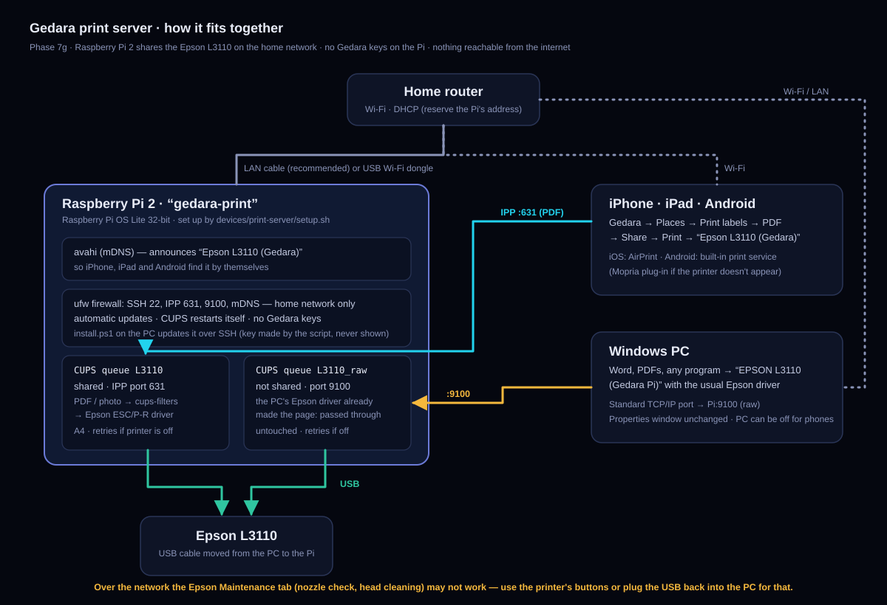

# Gedara print server (Phase 7g)

The Epson L3110 becomes a **home network printer** through the spare Raspberry Pi 2:

- **iPhone, iPad, Android** print Gedara's label sheets (and photos, documents) directly. The PC can be off.
- **This PC** keeps printing Word, PDFs and everything else with the **same Epson driver and Properties
  window** as today, through the printer "EPSON L3110 (Gedara Pi)".
- No change to the Gedara website or database, and **no Gedara keys on the Pi**.

| Read | For |
|---|---|
| [setup.md](setup.md) | **click by click**: prepare the card, one command, test from the PC and the phones |
| [troubleshooting.md](troubleshooting.md) | symptom → fix |
| [`devices/print-server/`](../../devices/print-server/README.md) | the scripts (for developers) |

## What works, and what doesn't
| | Through the Pi |
|---|---|
| Word, PDFs, any program on the PC | ✓ the same Print window and Epson Properties |
| Print from iPhone / iPad (AirPrint) | ✓ |
| Print from Android | ✓ built-in print service (or the free Mopria app) |
| PC switched off | ✓ phones still print (the Pi is on: about 3 W) |
| Printer switched off | a job waits on the Pi and prints when the printer comes on |
| Epson **Maintenance** tab (nozzle check, head cleaning), Status Monitor | ✗ probably not over the network: use the printer's buttons, or plug the USB back into the PC for that one job |
| Speed | PC prints: as before. Phone prints: the Pi 2 prepares the page, so a full label sheet can take about a minute to start |

## Parts
Raspberry Pi 2 · its case · microSD card 8 GB or more · 5 V 2 A micro-USB adapter · this PC's card
reader · **either** a network cable from the Pi to the router (recommended) **or** a USB Wi-Fi
adapter that works with Linux (setup.md, Stage B tells you what to check).
